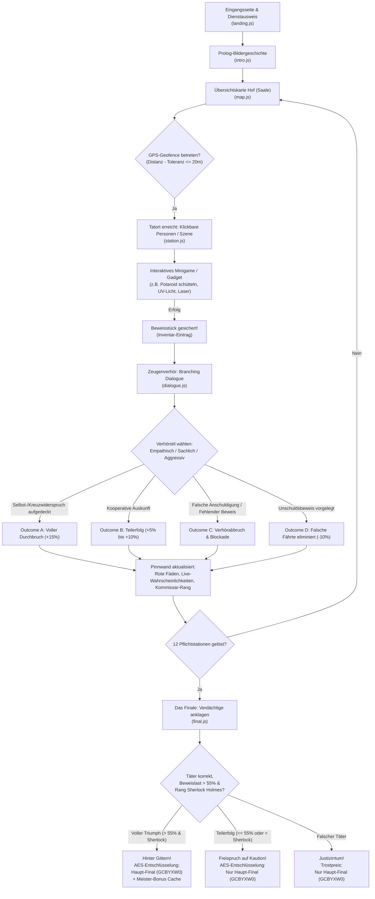

# KONZEPT – „Der Pakt der Schlappen-Erben“
## Master-Architektur & Gesamtkonzeption des geolokalisierten Krimi-Nachtcaches in Hof (Saale)

> **Stand:** 13. Oktober 2026 – *Version 2.5 (Gold Master / Betatest-Architektur)*  
> **Cache-Titel:** *„Der Pakt der Schlappen-Erben – Ein Nacht-Krimi in Hof (Saale)“*  
> **Geocaching-Typ:** Mystery / Unknown (Nachtcache) • **GC-Code:** GCBYXW0  
> **Autor & Owner:** *made by Versteckules* (Profil-Avatar: `assets/avatar.jpg`)  
> **Umfang:** 16 Stationen (12 Pflichtstationen, 2 optionale Bonusstationen, 1 Geheimbunker, 1 Easter-Egg Station)  
> **Spieldauer:** ca. 2,5 bis 3,5 Stunden • **Streckenlänge:** ca. 3,5 bis 4 Kilometer  
> **Zielplattform:** Progressive Web App (PWA) • 100% Offline-fähig • Noir / Graphic-Novel Ästhetik  
> **Begleitdokument:** [DIALOG_ARCHITEKTUR.md](file:///c:/Users/flaem/Desktop/Krimi/DIALOG_ARCHITEKTUR.md) (Detaillierte Verhör-Matrizen aller 19 Zeugen)

---

## 1. Entscheidungsübersicht & Verbindliche Kern-Vorgaben

| # | Themenbereich | Verbindliche Festlegung & Umsetzung |
|---|---------------|-------------------------------------|
| 1 | **Titel & Setting** | **„Der Pakt der Schlappen-Erben“** (Untertitel: *„Ein Nacht-Krimi in Hof (Saale)“*). Historischer Brand von 1823, verschwundene Brandakten und ein Geheimbund wohlhabender Patrizier. |
| 2 | **Eingangsseite & Dienstausweis** | Immer zugänglich ([landing.js](file:///c:/Users/flaem/Desktop/Krimi/js/ui/landing.js)). Interaktiver Dienstausweis, freie Namenseingabe, Akkordeon-Anleitung, Fortschrittsanzeige, Notfall-Button *„Akte Schreddern“* (Spielstand-Reset auf Startseite, im Dossier und im Finale) sowie Testmodi: Name **`OFFLINETEST`** (Couch-Testing) und **`ONSIDETEST`** (Vor-Ort-Test bei Tag). Owner-Badge (*made by Versteckules*). |
| 3 | **Dynamische Personalisierung** | Spieler vergibt eigenen Team- bzw. Ermittlernamen. Sämtliche Dialoge, Audio-Intros und Zwischenmeldungen sprechen den Spieler dynamisch mit `{PLAYER_NAME}` an. |
| 4 | **Trigger via GPS-Geofencing** | **Keine manuelle Texteingabe zur Stationsfreischaltung im Feld!** Betreten des GPS-Radius (Standard: 20 m Geofence, Toleranzabzug bis 15 m) schaltet den Tatort automatisch frei. Akustischer/haptischer Sonar-Puls ab 100 m Annäherung. Dev-/Debug-Modus (`?debug=1`) erlaubt Klick-Trigger. |
| 5 | **Zeitsperre & Nacht-Bedingung** | Spielbar erst ab Einbruch der Dunkelheit via SunCalc-Formel ([timelock.js](file:///c:/Users/flaem/Desktop/Krimi/js/timelock.js)): `max(18:00 Uhr, Sonnenuntergang + 30 Minuten)` bis Sonnenaufgang. Schloss-Overlay blockiert Tagsüber-Spielen. Betatester können die Zeitsperre via **`ONSIDETEST`** (mit realem GPS vor Ort) oder **`OFFLINETEST`** (vom Schreibtisch) umgehen. |
| 6 | **Zwingender Gadget-Zwang** | An **jeder** Station **MUSS zuerst ein interaktives Ermittler-Gadget / Minigame gelöst werden**, bevor der Zeugendialog beginnt. Kein reines Me-Too-Abklicken. Insgesamt 23 eigenständige Gadgets in `js/ui/gadgets/`. |
| 7 | **Dynamische Probability-Engine** | Drei Hauptverdächtige (*Valentin Herold*, *Katharina von Gipser*, *Severin Heiden*) besitzen Live-Schuldwahrscheinlichkeiten (0–100%). **Zwingende Freischaltung erst nach Station 1 (Rathaus):** Zu Beginn sind die Verdächtigen unbekannt; erst der Abschluss des Brandherds schaltet ihre Profile und GPS-Pins frei. |
| 8 | **Branching True-Detective Dialoge** | Komplexe Verhörbäume nach RPG-Hub-and-Spoke-Muster ([DIALOG_ARCHITEKTUR.md](file:///c:/Users/flaem/Desktop/Krimi/DIALOG_ARCHITEKTUR.md)). 19 Charaktere mit je 16–24 modularen Knoten, 3 Verhörstilen, Selbst- und Kreuzwidersprüchen sowie 4 distinkten Outcomes pro Zeuge. Keine vorgegebenen Täter-Namen! **Verhörfalle `[Druck erhöhen]`:** Unüberlegter Druck führt ohne erdrückende Beweise direkt zum Aussageboykott (Outcome C, 0 Punkte & kein Beweis). |
| 9 | **Kommissar-Ränge & Schwierigkeit** | 5 Ränge basierend auf Kommissarpunkten (Streifenpolizist bis Sherlock Holmes). Hohe Ränge erfordern zwingende Sachbeweise, schalten aber den roten *Sherlock-Tipp* auf der Karte und Rang-Boni bei der Beweiszuteilung frei. Höchster Rang *Sherlock Holmes* (≥ 700 XP & min. 8 Pflichtstationen) ist zwingende Voraussetzung für den Meister-Bonus! |
| 10| **Ermittler-Pinnwand & Vor-Ort-Verhör** | TV-Style Dossier ([dossier.js](file:///c:/Users/flaem/Desktop/Krimi/js/ui/dossier.js)). Polaroids der Verdächtigen werden dynamisch per HTML5-Canvas mit roten Fäden (*Red Strings*) an die Beweisstücke geheftet. **Kein Couch-Verhör aus dem Dossier:** Hauptverdächtige haben feste GPS-Punkte in Hof und können nur vor Ort per Geofencing (≤ 25 m) verhört werden! |
| 11| **Große Boss-Spiele** | Vor der finalen Konfrontation der Hauptverdächtigen triggern Spezial-Spiele: Drehscheiben-Tresor (Herold), Schredder-Rekonstruktion (Gipser) und interaktive Kirchenorgel (Heiden). |
| 12| **Zweistufiges Krypto-Finale** | Finale Geocache-Koordinaten liegen AES-GCM-verschlüsselt in [data/final.json](file:///c:/Users/flaem/Desktop/Krimi/data/final.json). **Haupt-Final (GCBYXW0)** schaltet immer frei; der exklusive **Meister-Bonus Cache** öffnet sich nur bei korrekter Täterüberführung mit **> 55% Beweislast UND Rang „Sherlock Holmes“** (≥ 700 XP & 8 Stationen). Das Diplom-Banner (`assets/diploma_banner.jpg`) dient als separates Listing-Asset; im Web-Finale gibt es kein Banner und keinen HTML-Code mehr (reine Krypto- & Koordinatenausgabe). |
| 13| **Vollvertonung & Audio-Engine** | Sämtliche 265 Audiosequenzen (alle 248 Verhörzeilen, Prolog, Outros, Easter-Eggs) professionell via Neural-TTS vertont. Web Audio API erzeugt prozedurale Synthesizer-Klangwelten pro Verdächtigem inklusive automatischem Audio-Ducking. |
| 14| **Reale Trackables (TB-Support)** | Vollständige Integration von 4 Geocaching-Trackables (`HQZJCG`, `EA99DB`, `CABGEW`, `CARGC7`) plus Geheimbund-TB `CA6D92`. |
| 15| **Geheime Easter Eggs** | 5 feste Easter Eggs (Versteckules-Ausweis, Wärschtlamo-Kessel, Kompass-Schwindel, Mitternachtsgeläut, Jean Pauls Geist) plus Sensor-Trigger (Geschwindigkeits- und Batteriewarnung). |
| 16| **PWA & Offline-Integrität** | 100% Client-seitig, speichert Zustand in `localStorage` (`krimi_state_v1`). Läuft autark ohne Internetempfang im Gelände. Service Worker (`sw.js`) cacht alle Assets. |

---

## 2. System- und Gameplay-Ablauf ("Next Level" Flow)



---

## 3. Die 16 Stationen & Streckenführung im Detail

Die Ermittlung führt über 16 historisch authentische Punkte durch die Hofer Innenstadt, Altstadt und Saale-Uferbereiche:

| Nr | ID | Name der Station | Typ | Koordinaten (DMM) | Zeugen / Personen | Standard-Gadget | Beweisstück / Reward |
|:--:|----|------------------|:---:|-------------------|-------------------|-----------------|----------------------|
| **1** | `rathaus` | **Historisches Rathaus (Brandherd)** | Pflicht | N 50° 19.313 E 011° 55.121 | Kommissar Stahl, Reporter Paul Stift | `time-slider` (Intro: `reporter-camera` / `policeman-paper`) | Brandstellen-Partitur / Fluchtauto-Foto |
| **2** | `hauptpost` | **Rotary Brunnen (Hauptpost)** | Pflicht | N 50° 19.123 E 011° 54.962 | Nachtkurier Sepp | `polaroid` (DeviceMotion) | `beweis_frachtpapiere` (Lieferschein) |
| **3** | `obelisk` | **Wittelsbacher Park (Obelisk)** | Pflicht | N 50° 18.728 E 011° 55.052 | Dr. Blume (Historiker) | `briefcase` (3D-Zahlenschloss) | `evidence_cipher_paper` |
| **4** | `lorenzkirche` | **St. Lorenz (Die Gruft)** | Pflicht | N 50° 18.893 E 011° 55.057 | Pfarrer Klement | `stealth` (Schrittzähler) | `beweis_pakt_ring` (Sekten-Siegelring) |
| **5** | `biengaesschen` | **Biengässchen (Fluchtweg)** | Pflicht | N 50° 18.907 E 011° 54.979 | Schankwirtin Erna | `laser` (Geschicklichkeit) | `evidence_briefcase_lock` |
| **6** | `ludwigstrasse` | **Ludwigstraße (Der Notar)** | Pflicht | N 50° 19.168 E 011° 55.004 | Wachmann Rolf | `scratch` (Ruß-Canvas) | `beweis_antike_uhr` (Goldene Taschenuhr) |
| **7** | `karolinenstrasse` | **Karolinenstraße (Telefonzelle)**| Pflicht | N 50° 19.306 E 011° 55.037 | Obdachloser Käpt'n | `fake-call` (Audio-Simulator) | `evidence_phone_warning` |
| **8** | `schlossplatz` | **Schlossplatz (Alte Residenz)** | Pflicht | N 50° 19.220 E 011° 54.950 | Fremdenführerin Lisa | `ambigram` (Gyroskop-Pergament) | `evidence_ambigram_mirror` |
| **9** | `sonnenplatz` | **Sonnenplatz (Das Wirtshaus)** | Pflicht | N 50° 18.981 E 011° 54.892 | Wärschtlamo Karl | `dice` (3D-Würfelarena) | `beweis_chorknaben_notiz` |
| **10**| `marienkirche` | **St. Marien (Die Predigt)** | Pflicht | N 50° 19.321 E 011° 55.167 | Mesnerin Gertrud | `wiretap` (Richtmikrofon) | `evidence_wiretap_log` |
| **11**| `michaeliskirche`| **St. Michaelis (Das Siegel)** | Pflicht | N 50° 19.321 E 011° 55.167 | Gärtner Huber | `cryptowheel` (Messing-Chiffre) | `evidence_brass_wheel` |
| **12**| `hospitalkirche` | **Hospitalkirche (Übergabeort)**| Pflicht | N 50° 19.455 E 011° 55.147 | Schwester Maria | `uv-light` (Schwarzlicht) | `evidence_uv_formula` |
| **13**| `saale_schmuggel`| **Saale-Ufer (Schmugglerpfad)** | Bonus | N 50° 19.462 E 011° 55.272 | Fischer Jan | `letter` (Dokument-Puzzle) | `evidence_torn_letter` (+15 XP) |
| **14**| `altstadt_archiv`| **Altes Spital (Geheimarchiv)** | Bonus | N 50° 19.425 E 011° 55.215 | Archivgehilfe Max | `whisper` (Web Speech API) | `evidence_charter_1432` (+15 XP) |
| **15**| `versteck_15` | **Schlappen-Versteck (Bunker)** | Bonus | N 50° 19.500 E 011° 55.100 | Schattenhafter Bote | `scanner` (WebRTC Kamera) | Geheimer Tresorschlüssel (+20 XP) |
| **16**| `jean_paul` | **Jean Pauls Geist (Geheimnis)**| Easter Egg| N 50° 19.035 E 011° 54.924 | Jean Pauls Geist | Eigene Geisterbeschwörung | Dichterfürst-Bonus (+30 XP) |

---

## 4. Das 23-Gadget-Arsenal (Interaktive Minispiele)

Jedes Gadget ist als eigenständiges ES-Modul in `js/ui/gadgets/` gekapselt und wird über den zentralen [gadget-manager.js](file:///c:/Users/flaem/Desktop/Krimi/js/ui/gadgets/gadget-manager.js) orchestriert. Hardware-Sensoren besitzen durchgängig automatisierte Fallbacks sowie einen Notfall-Abbruch-Button (*-10 XP*):

```
                                  ┌──────────────────────────┐
                                  │   gadget-manager.js      │
                                  └─────────────┬────────────┘
                                                │
         ┌────────────────────────┬─────────────┴────────────┬────────────────────────┐
         ▼                        ▼                          ▼                        ▼
 ┌───────────────┐        ┌───────────────┐          ┌───────────────┐        ┌───────────────┐
 │   Standard    │        │  Sensorische  │          │   Akustische  │        │   Boss-Fight  │
 │  Minigames    │        │   Gadgets     │          │    Gadgets    │        │  Spezialisten │
 ├───────────────┤        ├───────────────┤          ├───────────────┤        ├───────────────┤
 │ briefcase.js  │        │ polaroid.js   │          │ fake-call.js  │        │ safe.js       │
 │ coaster.js    │        │ ambigram.js   │          │ wiretap.js    │        │ shredder.js   │
 │ scratch.js    │        │ stealth.js    │          │ whisper.js    │        │ music-crypto- │
 │ uv-light.js   │        │ scanner.js    │          │               │ │ gram.js       │
 │ dice.js       │        │               │          │               │        │               │
 │ letter.js     │        │               │          │               │        │               │
 │ laser.js      │        │               │          │               │        │               │
 │ mugshot.js    │        │               │          │               │        │               │
 │ time-slider.js│        │               │          │               │        │               │
 └───────────────┘        └───────────────┘          └───────────────┘        └───────────────┘
```

### Die 23 Module in der Übersicht:

1. **`polaroid.js` (Polaroid schütteln):** Bildentwicklung durch echtes Schütteln des Smartphones (`devicemotion`). Fadet stufenlos von weißem Schleier zu scharfem Foto. Fallback: Manueller Schüttel-Button.
2. **`uv-light.js` (UV-Schwarzlichtlampe):** Violetter Lichtkegel folgt der Touch-Position. Reaktiviert unsichtbare Phosphor-Tinte auf historischem Papier (`destination-over`).
3. **`scratch.js` (Ruß-Freirubbeln):** HTML5 Canvas mit fotorealistischer Aschetextur (`destination-out`). Erfolgreich gelöst ab 60% freigerubbelter Fläche.
4. **`fake-call.js` (Retro-Geheimanruf):** Täuschend echter Wählscheiben- / Tastentelefon-Anruf mit Rufton, Vibrations-API (`navigator.vibrate`) und Wischgeste zum Abnehmen.
5. **`cryptowheel.js` (Messing-Chiffrierscheibe):** Zwei konzentrische Messingringe, die sich per Fingerstreich gegeneinander verdrehen lassen, bis Runen und Buchstaben golden aufblitzen.
6. **`ambigram.js` (Kopfüber-Ambigramm):** Magisches Pergament. Dreht der Spieler das Smartphone um 180 Grad (`deviceorientation`), transformiert sich die Spiegelschrift in Klartext.
7. **`coaster.js` (Bierdeckel-Puzzle):** Zerschnittene Wirtshaus-Bierdeckel als Drag-and-Drop Touch-Objekte mit magnetischem *Snap-to-Grid* beim Einrasten.
8. **`briefcase.js` (Aktenkoffer-Zahlenschloss):** Dreidimensionales 3D-CSS Drehzahlenschloss. Mechanischer Audio-Klick verrät die korrekte Zahlenwalze (Crack-by-Feel).
9. **`wiretap.js` (Richtmikrofon):** Animierter Equalizer. Horizontales Schwenken des Handys (Kompasspeilung) sucht das Rauschminimum, bis die abgehörte Stimme glasklar verständlich wird.
10. **`letter.js` (Erpresserbrief-Schnipsel):** Zerrissene Briefstücke müssen auf einem Mahagoni-Schreibtisch zu einem lesbaren Drohbrief zusammengesetzt werden.
11. **`laser.js` (Laser-Parcours):** Vogelperspektive auf einen Gang. Der Spieler zieht einen Dietrich mit dem Finger durch pulsierende rote Laserschranken, ohne sie zu berühren.
12. **`mugshot.js` (Phantombild-Baukasten):** Polizeilicher Karteikasten. Durchblättern von Gesichtsformen, Augenpartien, Frisuren und Narben, bis die Zeugenbeschreibung exakt übereinstimmt.
13. **`stealth.js` (Schleich-Schrittzähler):** Pedometer via Beschleunigungsmesser. Der Spieler muss sich 15 Schritte lang behutsam bewegen, ohne einen dB-Grenzwert zu überschreiten (Fallback: Rhythmus-Tippen).
14. **`dice.js` (Wirtshaus-Würfeln):** Physikalischer 3D-Würfelbecher. Geschüttelt per Touch oder Bewegung; erfordert einen Wurf von mehr als 8 Augen (unbegrenzte Versuche).
15. **`time-slider.js` (Zeitreise-Slider):** Interaktiver Vorher-Nachher-Bildtrenner vergleicht das historische Rathaus von 1823 mit dem aktuellen Zustand.
16. **`whisper.js` (Flüster-Passwort):** Spracherkennung via Web Speech API (`SpeechRecognition`). Erkennt das geflüsterte Lösungswort („SCHLAPPEN“).
17. **`scanner.js` (Infrarot-Scanner):** Aktiviert die Smartphone-Kamera (WebRTC) mit Grün-/Infrarot-Filter zur Erkennung versteckter Symbole an Mauerwerken.
18. **`reporter-camera.js` (Autofokus-Kamera):** Intro-Spezialspiel am Rathaus. Schärfe-Schieberegler stellt das Fluchtfahrzeug der Stadträtin scharf.
19. **`policeman-paper.js` (Notenblatt-Rubbeln):** Intro-Spezialspiel am Rathaus. Rußentfernung legt die B-A-C-H Partitur des Domorganisten frei.
20. **`safe.js` (Tresor Valentin Herold):** Großer Boss-Fight. Gyroskop-Drehrad zur Eingabe der Kombination `18 - 23 - 0`.
21. **`shredder.js` (Schredder Katharina von Gipser):** Großer Boss-Fight. 3x3 Kachel-Verschiebespiel rekonstruiert vernichtete Verträge des Bauamts.
22. **`music-cryptogram.js` (Musikalische Orgel Severin Heiden):** Großer Boss-Fight. Virtuelles Kirchenorgel-Keyboard mit echter Web Audio API Synthese zur Einspielung von B-A-C-H.
23. **`gadget-manager.js` (Zentraler Controller):** Handhabt Laden, Fallbacks, Belohnungszuteilung ins Inventar und den globalen Abbruch-Button (*-10 XP*).

---

## 5. Kriminalistische Dialog-Architektur ("True Detective")

Gemäß dem Master-Dokument [DIALOG_ARCHITEKTUR.md](file:///c:/Users/flaem/Desktop/Krimi/DIALOG_ARCHITEKTUR.md) wurden alle linearen Frage-Antwort-Ketten durch ein vollwertiges Hub-and-Spoke Verhörsystem ersetzt:

### Die 4 Kriminalistischen Grundsätze:
1. **Kein Name in den Mund gelegt:** Der Ermittler fragt niemals: *„Kennen Sie Valentin Herold?“*, sondern: *„Beschreiben Sie den Mann mit dem Gehstock genauer.“* Der Spieler verknüpft die Personenmerkmale eigenständig im Dossier.
2. **Selbst-Widersprüche:** Jeder Zeuge verstrickt sich bei gezieltem Nachbohren in eigene Widersprüche (z. B. erst vorgeben zu schlafen, später von einem lauten Auto berichten). Klick auf `[Selbstwiderspruch vorhalten]` bricht die Mauer.
3. **Kreuz-Widersprüche:** Zeugenaussagen kollidieren frontal (z. B. Schwester Maria meldet Flucht nach Norden; Fischer Jan schwört auf eine Bootsflucht). Nur der gefundene Sachbeweis entlarvt den Lügner.
4. **4 Feste Outcomes pro Charakter:**
   - **Outcome A (Voller Durchbruch):** Geständnis oder Schlüsseltatsache, liefert **+15% Verdacht** beim wahren Täter.
   - **Outcome B (Teilerfolg):** Bestätigt Teilaspekte, liefert **+5% bis +10% Verdacht**.
   - **Outcome C (Blockade):** Zeuge bricht das Gespräch ab (z. B. bei Vorwürfen ohne Sachbeweis im Inventar).
   - **Outcome D (Entlastung):** Beweist die Unschuld einer falschen Fährte (**-10% Verdacht**).

---

## 6. Kommissar-Ränge & Dynamisches Balancing

Mit gelösten Stationen, Beweisen und korrekten Verhören sammelt der Spieler *Kommissarpunkte*. Daraus errechnet sich der aktuelle Dienstgrad ([state.js](file:///c:/Users/flaem/Desktop/Krimi/js/state.js)):

| Rang-Stufe | Dienstgrad | Punktebereich | Mechanische Auswirkung & Balancing |
|:----------:|------------|:-------------:|-----------------------------------|
| **1** | **Streifenpolizist** | 0 – 149 XP | Zeugen plaudern leichtfertig, lassen Details fallen. Harte Konfrontationen misslingen. |
| **2** | **Schnüffler** | 150 – 299 XP | Solide Basis, Zeugen reagieren neutral auf formelle Fragen. |
| **3** | **Privatdetektiv** | 300 – 499 XP | **Vorteil:** Schaltet den roten **„Sherlock-Tipp“**-Button auf der Karte frei (präzise Empfehlung der nächsten Station).<br>**Nachteil:** Zeugen werden misstrauisch; brisante Fragen verlangen Sachbeweise im Inventar. |
| **4** | **Inspektor** | 500 – 699 XP | Zeugen blocken Standard-Ausreden ab. +9% Rangbonus bei korrekter Beweiszuordnung. |
| **5** | **Sherlock Holmes** | 700+ XP | Höchste Stufe (erfordert min. 8 gelöste Pflichtstationen): +12% Rangbonus auf Beweise, maximaler Schärfebonus (+32 Pkt) bei der finalen Täterüberführung. **Zwingende Voraussetzung für den Meister-Bonus-Cache.** |

---

## 7. Ermittler-Pinnwand (Evidence Board / Dossier)

Das Dossier ([dossier.js](file:///c:/Users/flaem/Desktop/Krimi/js/ui/dossier.js)) bildet das Herzstück der Deduktion:
- **Evidence Board:** Dunkle Korkwand mit Polaroid-Fotos der drei Hauptverdächtigen, Stecknadeln und gesammelten Beweiskarten.
- **Rote Fäden (Canvas Red Strings):** Sobald ein Beweis zugeordnet wird, zieht ein animierter roter Wollfaden von der Beweiskarte zum Polaroid des Verdächtigen.
- **Punkte- & Verdachts-Wirkung:**
  - *Korrekte Zuordnung:* **+15% Verdacht** (+ bis zu **+12% Rangbonus** bei Rang 5).
  - *Falsche Zuordnung:* **-7% Verdacht**, **-5 Kommissarpunkte**.
  - *Einmalige Korrektur:* Jeder Beweis darf genau einmal re-evaluiert und umgehängt werden.
- **Live-Schuldbarometer:** Fortschrittsbalken zeigen in Echtzeit den aktuellen Verdachtsgrad jedes Kandidaten an.
- **Akte schreddern (Reset-Funktion):** Direkter Reset-Button im Header des Dossiers erlaubt das Zurücksetzen des Spielstands bei Neustart.

---

## 8. Die drei Hauptverdächtigen & Boss-Spiele

```
                  ┌────────────────────────────────────────────────────────┐
                  │                 DIE 3 HAUPTVERDÄCHTIGEN                │
                  └───────────────────────────┬────────────────────────────┘
                                              │
         ┌────────────────────────────────────┼────────────────────────────────────┐
         ▼                                    ▼                                    ▼
 ┌────────────────────────┐          ┌────────────────────────┐          ┌────────────────────────┐
 │   Valentin Herold      │          │  Katharina von Gipser  │          │     Severin Heiden     │
 ├────────────────────────┤          ├────────────────────────┤          ├────────────────────────┤
 │ Antiquitätenhändler    │          │ Baudezernentin         │          │ Domorganist            │
 │ Samtweste & Gehstock   │          │ Elegantes Kostüm       │          │ Schute & Chorgewand    │
 │ Motiv: Gier & Antiqui- │          │ Motiv: Vertuschung     │          │ Motiv: Fanatische      │
 │ täten-Schwarzmarkt     │          │ alter Baubeschränkungen│          │ Geheimbund-Tradition   │
 ├────────────────────────┤          ├────────────────────────┤          ├────────────────────────┤
 │ Boss-Gadget: safe.js   │          │ Boss-Gadget:           │          │ Boss-Gadget: music-    │
 │ (3D-Drehrad-Tresor)    │          │ shredder.js (Schredder)│          │ cryptogram.js (Orgel)  │
 ├────────────────────────┤          ├────────────────────────┤          ├────────────────────────┤
 │ Audio: 45Hz Sinus-Bass │          │ Audio: Triangle Puls   │          │ Audio: Square Sakral-  │
 │ Grollen der Unterwelt  │          │ Stress-Herzschlag      │          │ Orgelatmosphäre        │
 └────────────────────────┘          └────────────────────────┘          └────────────────────────┘
```

### Feste Standorte & Vor-Ort-Verhör-Mechanik:
Die Hauptverdächtigen sind reale Personen im Stadtgebiet von Hof und können **nicht** per Klick aus dem Dossier verhört werden:

| Verdächtige(r) | Rolle | Fester GPS-Standort (DMM) | Örtlichkeit in Hof | Boss-Minigame |
|---|---|---|---|---|
| **Valentin Herold** | Antiquitätenhändler | `N 50° 19.362 E 011° 55.212` | Altstadt / Lorenzberg | `safe.js` (Tresor-Drehrad) |
| **Katharina von Gipser** | Baudezernentin | `N 50° 19.313 E 011° 55.033` | Neustadt / Karolinenstraße | `shredder.js` (Dokument-Puzzle) |
| **Severin Heiden** | Domorganist | `N 50° 19.137 E 011° 55.066` | Kirchplatz St. Michaelis | `music-cryptogram.js` (Orgel) |

* **Freischaltung:** Pins und Profile erscheinen erst nach erfolgreichem Abschluss von **Station 1 (Historisches Rathaus)**. Vorher sind die Verdächtigen für den Spieler unbekannt.
* **Geofence-Trigger:** Erreicht der Spieler den 20-Meter-Radius eines Verdächtigen, schaltet der Navigator das Verhör automatisch frei.
* **Karten-Popup & Dossier:** Ein Verhör ist nur vor Ort am GPS-Punkt (Geofence $\le 25\text{ m}$) möglich (im `OFFLINETEST`-Modus auch remote).
* **Maximal 2 Verhöre pro Hauptverdächtigem (Cooldown-System):**
  - **1. Erstverhör:** Erstes Vorfühlen am Standort.
  - **3-Stationen-Sperre:** Nach dem 1. Verhör sperrt der Verdächtige ab. Erst nach Lösen von mindestens 3 weiteren Ermittlungsstationen schaltet neues Beweismaterial das 2. Verhör frei. UI zeigt: `⏳ Noch X Station(en) lösen`. Im Endgame (nach Abschluss aller 12 Pflichtstationen) entfällt diese Mindest-Wartezeit automatisch, damit verbleibende Zweitverhöre vor der Verhaftung noch geführt werden können.
  - **2. Nachverhör:** Ermöglicht die Konfrontation mit den neu gesammelten Beweisen (z. B. Rolfs Taschenuhr, Frachtpapiere, UV-Chornoten).
  - **Aussageverweigerung:** Nach 2 Verhören verweigert der Verdächtige auf Anraten seines Anwalts jedes weitere Wort (`🚫 Aussage verweigert (Max. 2 Verhöre)`). Punkt- und Verdachts-Farming ist damit ausgeschlossen.
  - **Boss-Minispiel-Schutz:** Jedes Boss-Minispiel (`safe.js`, `shredder.js`, `music-cryptogram.js`) kann nur einmalig gelöst werden; der Verdachtsbonus (+15 %) wird nicht doppelt gewertet. Ein Abbruch mit dem „✕“-Button schließt das Fenster, ohne die Lösung dauerhaft zu sperren.

---

## 9. Zweistufiges Finale & Krypto-Sicherheit

Sobald alle 12 Pflichtstationen absolviert sind, öffnet sich der Gerichtssaal ([final.js](file:///c:/Users/flaem/Desktop/Krimi/js/ui/final.js)):

### Die 3 Urteils-Outcomes:
1. **Voller Triumph (Korrekter Täter, Beweislast > 55% UND Rang „Sherlock Holmes“):**
   - Der Täter gesteht vollständig, Handschellen klicken, der Haftrichter verhängt Untersuchungshaft.
   - **Belohnung:** Entschlüsselung beider Caches: **Haupt-Final (GCBYXW0)** UND exklusiver **Meister-Bonus Cache** (Koordinaten & Hint direkt im Display freigeschaltet, kein separater Bonus-Textcode nötig).
2. **Teilerfolg (Korrekter Täter, aber Beweislast ≤ 55% ODER Rang unter „Sherlock Holmes“):**
   - Täter gesteht zwar, wird jedoch mangels erdrückender Beweiskette oder fehlendem Sherlock-Status gegen Kaution auf freien Fuß gesetzt. Spuren zum Bonus-Versteck werden vernichtet.
   - **Belohnung:** Entschlüsselung des **Haupt-Finals (GCBYXW0)**. Bonus-Cache bleibt verschlossen.
3. **Niederlage / Justizirrtum (Falsche Person angeklagt):**
   - Ein Unschuldiger wird beschuldigt; der wahre Täter entkommt unerkannt mit den Urkunden.
   - **Trostpreis:** Aus Gnade der Ermittlungsbehörde werden die Koordinaten des **Haupt-Finals (GCBYXW0)** dennoch freigegeben, damit der Geocacher die Dose vor Ort loggen kann.

### Finale-Präsentation & Listing-Banner:
- **Kein Banner & kein HTML-Code im In-Game-Finale:** Das Web-Finale verzichtet vollständig auf eingebettete Bannergrafiken oder HTML-Codeschnipsel, um auf Smartphones maximale Übersichtlichkeit und Fokus auf Koordinaten und Hints zu gewährleisten.
- **Listing-Asset:** Das gestaltete Diplom-Banner (`assets/diploma_banner.jpg`) mit eingestanztem GC-Code `GCBYXW0` wird außerhalb der PWA vom Cache-Owner direkt für das offizielle Geocaching.com-Listing genutzt.
- **Akte schreddern:** Direkter Reset-Button im Finale ermöglicht Spielern oder Testern ein sauberes Zurücksetzen auf die Startseite.

### AES-GCM Verschlüsselungs-Architektur:
Die finalen Daten liegen niemals in lesbarem Klartext im Webcode, sondern in [data/final.json](file:///c:/Users/flaem/Desktop/Krimi/data/final.json). Die Passphrasen werden dynamisch aus Spielzustand und Täter-Identität via PBKDF2 und AES-GCM generiert ([crypto.js](file:///c:/Users/flaem/Desktop/Krimi/js/crypto.js)):
- Lokale Klartextkoordinaten verbleiben geschützt in [data/final_plain.json](file:///c:/Users/flaem/Desktop/Krimi/data/final_plain.json) (mittels `.gitignore` vor Repositories geschützt).
- Verschlüsselung erfolgt automatisiert über `tools/encrypt_final.ps1` oder `tools/encrypt_final.html`.

---

## 10. Audiovisuelle Inszenierung & Vertonung

- **265 Fertige Audio-Dateien:**
  - Sämtliche 248 Verhör-Dialogzeilen, Intro-Prologe, Outro-Kapitel und Geständnisse liegen druckfrisch unter `assets/audio/dialogues/` und `assets/audio/story/`.
  - Generiert via Neural-TTS mit rollenspezifischen Charakterstimmen und optimiertem Sprechtempo (+25%).
- **Dynamische Web Audio API Klangsynthese:**
  - Automatisches Audio-Ducking (weiches Ausblenden der Hintergrundmusik) während der Zeugenbefragung.
  - Generative Frequenz-Atmosphäre pro Verdächtigem (Herold: 45 Hz Sinusgrollen; Gipser: Triangle LFO Herzschlag; Heiden: Zweistimmige Kirchenorgel).
  - Taktile SFX: Schreibmaschinen-Klackern, mechanischer Schloss-Klick, Sonar-Pulse, Geigen-Staccato und Geigerzähler.
- **Noir-Ästhetik & UI-Polish:**
  - „Atmende“ Avatare (sanftes Skalieren und Pulsieren der Charakterporträts).
  - Geschmeidige Page-Transitions (400 ms Ease) zwischen Karte, Dossier und Tatort.
  - Physisches Button-Shake bei riskanten Dialogentscheidungen.

---

## 11. Die Geheimen Easter Eggs & Travelbugs

1. **Easter Egg 1 – Versteckules-Name:**
   - Eingabe von *„Versteckules“* im Namensfeld des Dienstausweises ([landing.js](file:///c:/Users/flaem/Desktop/Krimi/js/ui/landing.js)).
   - **Belohnung:** Goldenes Master-Badge, **+50 Punkte** und Freischaltung des geheimen Trackables **TB CA6D92**.
2. **Easter Egg 2 – Wärschtlamo-Kessel:**
   - Dreimaliges Antippen des dampfenden Wurstkessels im Würfel-Gadget ([dice.js](file:///c:/Users/flaem/Desktop/Krimi/js/ui/gadgets/dice.js)).
   - **Belohnung:** Wumms-Sound, **+50 Punkte** und die legendäre Wiener-Würstchen-Meldung.
3. **Easter Egg 3 – Kompass-Schwindel:**
   - Dreimaliges schnelles Im-Kreis-Drehen auf der Übersichtskarte.
   - **Belohnung:** Animierter Display-Sprung (`glass-crack`), Verwirrungs-Sound und Zitat von Jean Paul.
4. **Easter Egg 4 – Mitternachts-Glockenschlag:**
   - Betreten der Michaeliskirche exakt um Mitternacht (00:00 bis 00:15 Uhr).
   - **Belohnung:** Unheimliches Domgeläut und **+25 Bonuspunkte**.
5. **Easter Egg 5 – Jean Pauls Geist (Station 16):**
   - Am Jean-Paul-Weg erscheint die Geistererscheinung des Hofer Dichterfürsten mit eigener vertonter Questline ([story.json](file:///c:/Users/flaem/Desktop/Krimi/data/story.json)) und **+30 Bonuspunkten**.
6. **Sensorische Bonus-Trigger:**
   - *Speed Demon:* Warnmeldung bei Bewegung über 30 km/h (Autofahrt).
   - *Low Battery:* Warnung bei Akkustand unter 15%.
   - *Offline Alert:* Alarmierung beim Abreißen des Internetempfangs.
7. **Reale Trackables:**
   - Im Spielverlauf freischaltbare Geocaching-TBs: `HQZJCG`, `EA99DB`, `CABGEW`, `CARGC7`.

---

## 12. Weg-Events & Straßen-Zufallsbegegnungen

In [data/events.json](file:///c:/Users/flaem/Desktop/Krimi/data/events.json) sind 8 dynamische Straßenbegegnungen hinterlegt, die während des Fußwegs zwischen Stationen unerwartet aufpoppen:
- **Der fliehende Schatten (Sprint):** 90 Sekunden Zeit, um die nächste Straßenecke im Biengässchen zu erreichen (+10 Indizien-Punkte).
- **Der Hofer Nachtwächter (Dialog):** Schlagfertige Antwort stimmt Nachtwächter Kilian milde; er überreicht eine historische Karte.
- **Der Wärschtlamo-Servietten-Code (Rubbeln):** Freiwischen von Senfflecken auf einer Serviette enthüllt `1823-HOF-SCHLAPPEN`.
- **Die klingelnde Telefonzelle (Call):** Hörer innerhalb von 15 Sekunden abnehmen sichert eine Warnung vor Verrat.
- **Der verlorene Schlüsselbund (Investigate):** Im Laub funkelnder Buntbartschlüssel schaltet Archivtüren frei.

---

## 13. Technische PWA-Architektur & Wartungs-Infrastruktur

### State-Schema (`localStorage: krimi_state_v1`):
```json
{
  "version": 1,
  "playerName": "Sherlock",
  "gameStarted": true,
  "startedAt": 1791850000000,
  "score": 165,
  "isTestingMode": false,
  "isOnsiteTestMode": false,
  "solvedStations": ["rathaus", "hauptpost", "obelisk"],
  "stationOrder": ["rathaus", "hauptpost", "obelisk"],
  "bonusSolved": ["saale_schmuggel"],
  "suspectScores": { "herold": 45, "gipser": 15, "heiden": 30 },
  "inventory": ["beweis_frachtpapiere", "evidence_cipher_paper"],
  "assignedEvidence": { "beweis_frachtpapiere": "gipser" },
  "reassignedEvidence": {},
  "unlockedTrackables": ["HQZJCG", "CA6D92"],
  "easterEggVersteckules": true,
  "easterEggWaerchtlamo": true
}
```

### Betatest-Accounts (Namenseingabe im Dienstausweis):
- **`OFFLINETEST` (Couch-Testing / Schreibtisch):**
  - Setzt `isTestingMode: true` und `isOnsiteTestMode: false`.
  - **Zeitsperre:** Deaktiviert (Start zu jeder Tageszeit).
  - **GPS-Radius:** Deaktiviert; Stationen und Verdächtige lassen sich per Klick auf der Karte öffnen.
- **`ONSIDETEST` (Vor-Ort-Betatest bei Tag):**
  - Setzt `isTestingMode: false` und `isOnsiteTestMode: true`.
  - **Zeitsperre:** Deaktiviert (erlaubt Betatestern das Begehen der Runde bei Tageslicht).
  - **GPS-Radius:** **Voll aktiv!** Betatester müssen real vor Ort in Hof an den exakten Koordinaten stehen (Geofence $\le 20\text{ m}$ / $\le 25\text{ m}$), um Stationen und Verhöre zu triggern.

### Wartungs- & Starter-Skripte:
- **`START.bat`:** Startet lokalen HTTP-Server (Port 8080) und öffnet direkt den Standardbrowser.
- **`SPRACH_BACKUP_WIEDERHERSTELLEN.bat`:** Sicherheitsnetz zur 1:1 Wiederherstellung aller sauberen JSON-Masterdateien aus `backup/`.
- **`SPRACH_DATEIEN_AKTUALISIEREN.bat`:** Vollautomatischer Neural-TTS-Generator für veränderte Dialogtexte in `story.json`.
- **`tools/cross_check.py`:** Umfassendes Validierungsskript für Dialog-Referenzen, Audiodateien und Stationen.
- **`tools/encrypt_final.ps1`:** Skript zur AES-GCM Verschlüsselung privater Geocache-Koordinaten.
